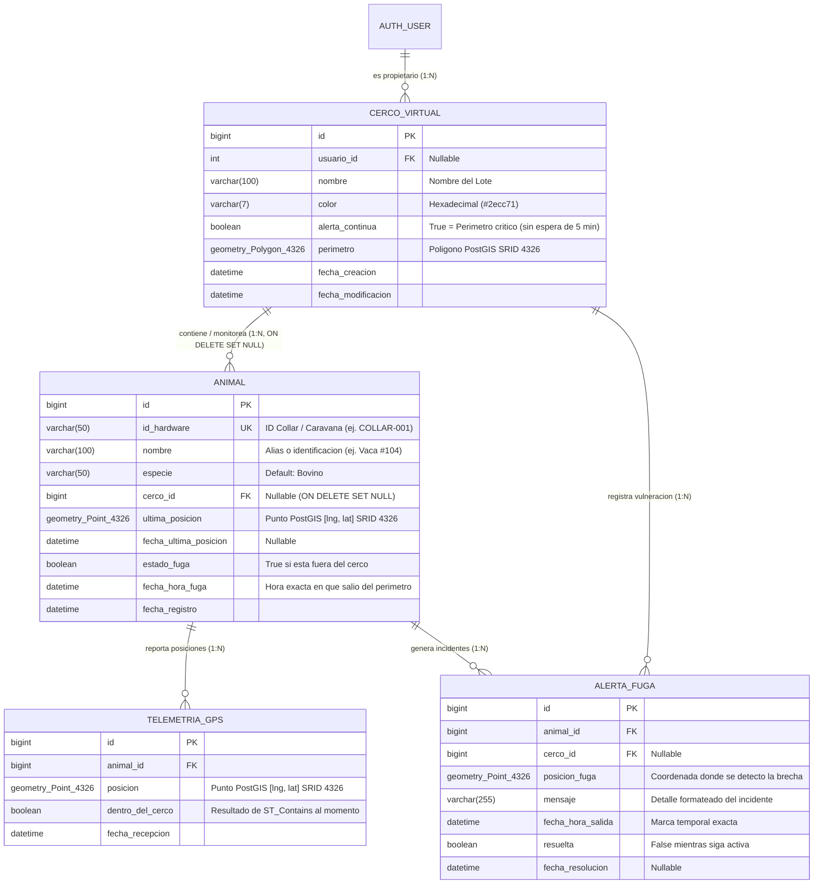
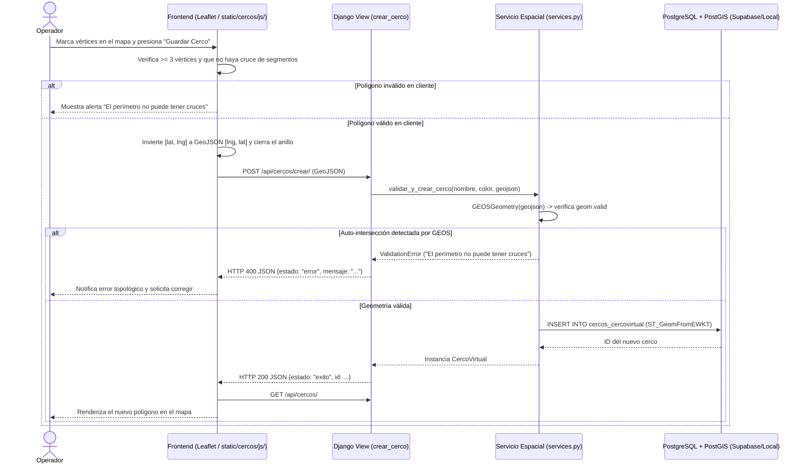
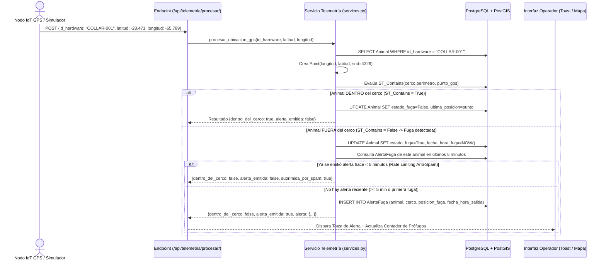

# Documento de Diseño del Sistema (SDD / Diseño Técnico)
**Proyecto:** SmartHerd — Módulo de Cercos Virtuales y Monitoreo Geoespacial Ganadero  

---

## 1. Modelo Entidad-Relación Espacial (DER)

El diseño de base de datos extiende el diagrama original incorporando los atributos espaciales de **PostGIS (`Geometry: Polygon` y `Geometry: Point` en `SRID 4326`)** y las tablas de trazabilidad de telemetría e incidentes de fuga.

---

## 2. Diagramas de Secuencia de los Flujos Críticos

### 2.1. Creación y Validación Topológica de un Cerco Virtual (`CU_01` / `RF_1`)

### 2.2. Procesamiento de Telemetría GPS, Detección Espacial y Emisión de Alerta (`CU_05` + `CU_06`)

---

## 3. Especificación de Contratos de la API (Para Integración con Otros Equipos)

Todos los endpoints devuelven y reciben `application/json`.

### 3.1. Endpoints de Cercos Virtuales
| Método | Ruta | Descripción |
| :--- | :--- | :--- |
| `GET` | `/api/cercos/` | Retorna un `FeatureCollection` GeoJSON con todos los cercos y la cantidad de animales asignados y prófugos en cada uno. |
| `POST` | `/api/cercos/crear/` | Crea un cerco. Body: `{"nombre": "Lote 1", "color": "#2ecc71", "geometria": {"type": "Polygon", "coordinates": [...]}}`. |
| `POST` | `/api/cercos/<id>/editar/` | Actualiza nombre, color y/o geometría de un cerco y re-evalúa la contención de sus animales asignados. |
| `POST` | `/api/cercos/<id>/eliminar/` | Elimina el cerco y desvincula (`cerco = NULL`) sus animales. |

### 3.2. Endpoints de Ganado y Pertenencia (`RF-08`, `RF-09`, `RF-10`)
| Método | Ruta | Descripción |
| :--- | :--- | :--- |
| `GET` | `/api/animales/` | Retorna la lista completa de animales con su `id_hardware`, `nombre`, `cerco_id`, `cerco_nombre`, `estado_fuga`, `fecha_hora_fuga` y coordenadas `[latitud, longitud]`. |
| `POST` | `/api/animales/crear/` | Registra un nuevo animal/collar. Body: `{"id_hardware": "COLLAR-001", "nombre": "Vaca #104", "especie": "Bovino", "cerco_id": 1, "latitud": -28.469, "longitud": -65.785}`. |
| `POST` | `/api/animales/<id>/asignar-cerco/` | Implementa **`RF-08` (Asignar)** y **`RF-09` (Modificar pertenencia)**. Body: `{"cerco_id": 2}`. |
| `POST` | `/api/animales/<id>/desvincular-cerco/` | Implementa **`RF-10` (Desvincular)**. Pasa `cerco = NULL`, limpia `estado_fuga` y resuelve alertas abiertas del animal. |
| `POST` | `/api/animales/<id>/eliminar/` | Da de baja un registro de animal. |

### 3.3. Endpoints de Telemetría GPS, Alertas y Modos de Operación (`RF_3`–`RF_7`)
| Método | Ruta | Descripción |
| :--- | :--- | :--- |
| `POST` | `/api/telemetria/procesar/` | **Endpoint para el Gateway IoT o el Simulador**. Body: `{"id_hardware": "COLLAR-001", "latitud": -28.472, "longitud": -65.781}` (también acepta `animal_id`). Evalúa `ST_Contains` en PostGIS y retorna si está dentro o fuera y si disparó alerta. |
| `GET` | `/api/alertas/?modo=real\|simulacion` | Retorna la lista de animales actualmente prófugos (`RF_6`, `RF_7`) y las alertas activas pendientes de revisión. |
| `POST` | `/api/alertas/<id>/resolver/` | Permite marcar una alerta/incidente como revisado o resuelto desde el Centro de Monitoreo de Fugas. |
| `POST` | `/api/demo/cargar/` | Crea/actualiza el escenario de demostración en Catamarca (2 lotes y 4 animales `COLLAR-101`..`104`) para pruebas en `🧪 Modo Simulación`. |
| `POST` | `/api/demo/limpiar/` | Elimina exclusivamente los registros de demostración sin afectar cercos ni animales reales del productor. |

