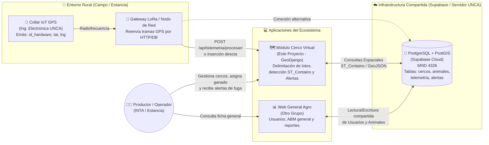

# Nivel 1 (C4 Contexto): Ecosistema IoT Ganadero (UNCA)

Este diagrama muestra cómo encaja el **Módulo de Cercos Virtuales** dentro del proyecto general junto al equipo de **Ingeniería Electrónica (Hardware IoT)** y el equipo de la **Plataforma Web General**.

## Puntos Clave de Integración entre Grupos

1. **Desacoplamiento mediante Base de Datos en la Nube (Supabase)**:
   - Al alojar PostgreSQL + PostGIS en **Supabase**, ninguno de los grupos depende de que la computadora personal de un integrante esté encendida.
2. **Doble vía de entrada para los Collares GPS**:
   - El nodo de red de Ingeniería Electrónica puede enviar un simple `POST /api/telemetria/procesar/` con JSON `{"id_hardware": "COLLAR-001", "latitud": -28.469, "longitud": -65.785}` a nuestra aplicación Django, **o bien** nuestro simulador integrado en el mapa permite demostrar todo el flujo en vivo durante conferencias sin requerir que el collar físico esté prendido en ese instante.
3. **Autonomía del Módulo de Cercos Virtuales**:
   - Aunque el sistema puede leer animales cargados por el otro grupo en la base de datos, incluye su propio panel de registro rápido de animales/collares para funcionar de manera 100% autónoma en demostraciones, pruebas y despliegues independientes.

