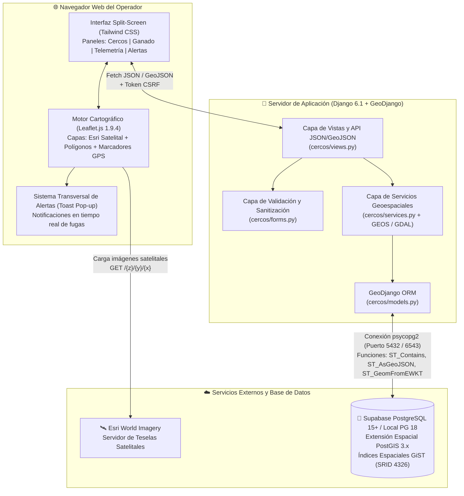

# Nivel 2 (C4 Contenedores): Interacción Frontend, Backend GeoDjango y PostGIS

## Responsabilidades por Contenedor

| Contenedor | Tecnología | Responsabilidad Principal |
| :--- | :--- | :--- |
| **Visor Cartográfico** | Leaflet.js + Esri | Renderizar el mapa satelital de Catamarca, capturar clics de dibujo, permitir arrastrar vértices y mostrar la posición de cada vaca con código de colores (verde = dentro del cerco, rojo = prófuga, gris = sin cerco). |
| **Servidor GeoDjango** | Python + Django + GEOS | Validar que los polígonos sean topológicamente correctos (`GEOSGeometry.valid`), gestionar transacciones atómicas y exponer la API REST/GeoJSON. |
| **Motor Espacial PostGIS** | PostgreSQL + PostGIS (Supabase) | Almacenar tipos nativos `geometry(Polygon, 4326)` y `geometry(Point, 4326)` y resolver mediante índices espaciales si la coordenada de un collar está contenida en su lote (`ST_Contains`). |

