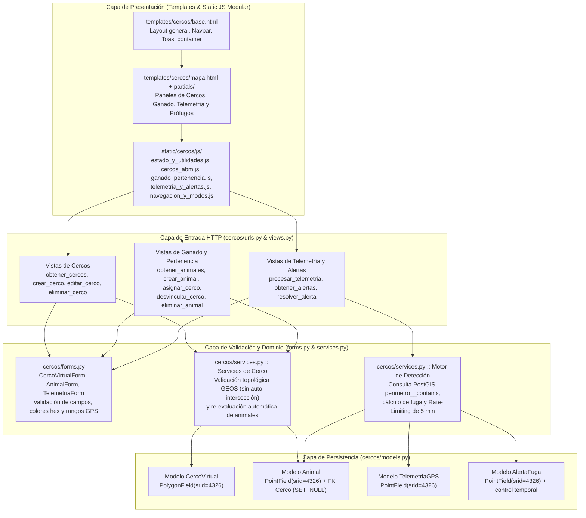

# Nivel 3 (C4 Componentes): Estructura Interna de la Aplicación `cercos`

Para superar las limitaciones del prototipo inicial (donde toda la lógica estaba concentrada en las vistas sin formularios ni capa de servicios), la aplicación `cercos` se organiza en capas bien definidas:

## Descripción de Archivos Clave

- [`cercos/models.py`](../../cercos/models.py): Define las 4 tablas espaciales (`CercoVirtual`, `Animal`, `TelemetriaGPS`, `AlertaFuga`).
- [`cercos/forms.py`](../../cercos/forms.py): Formularios de Django que validan tipos de datos, longitudes de texto, formato hexadecimal de colores y rangos geográficos ($[-90, 90]$ para latitud y $[-180, 180]$ para longitud).
- [`cercos/services.py`](../../cercos/services.py): Contiene las reglas de negocio puras documentadas en OpenSpec y la ERS:
  - Conversión de GeoJSON a `GEOSGeometry(..., srid=4326)` y verificación de `geometria.valid` (rechazando polígonos con líneas cruzadas).
  - Evaluación espacial `CercoVirtual.objects.filter(pk=cerco.id, perimetro__contains=punto).exists()`.
  - Ventana anti-spam de 5 minutos (`timedelta(minutes=5)`) antes de emitir una nueva `AlertaFuga`.
- [`cercos/views.py`](../../cercos/views.py): Controladores HTTP livianos que delegan la validación a `forms.py` y la lógica espacial a `services.py`.

